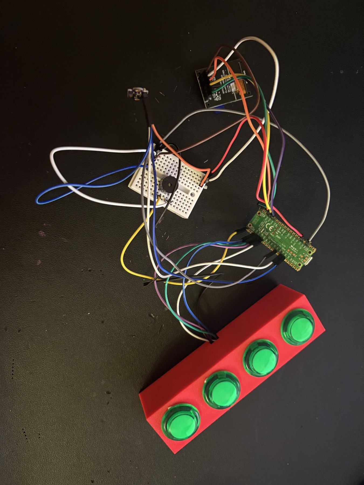
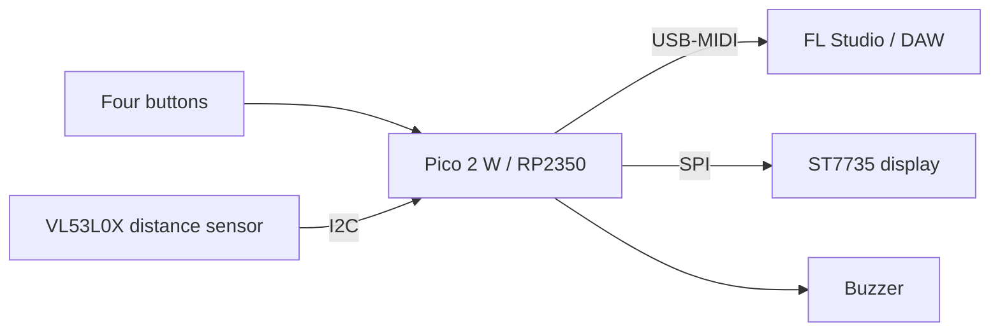

# Lumentra USB-MIDI Controller

**A compact Rust MIDI controller for Raspberry Pi Pico 2 W, combining four note buttons with touchless expression control.**

Lumentra uses the RP2350's native USB interface to send MIDI to a DAW such as FL Studio. A VL53L0X distance sensor turns hand movement into MIDI CC messages, while an ST7735 display and buzzer provide local feedback.

<p align="center">
  
</p>

*Physical prototype with its four-button enclosure and connected electronics.*

## Architecture



## MIDI mapping

| Input | Message |
| --- | --- |
| Buttons 1-4 | Notes 36, 38, 42, 46; Note On on press and Note Off on release |
| Button velocity | 110 |
| Distance sensor | CC 74, value 0-127; mapping bounds 40-450 mm |
| MIDI channel | Channel 1 (zero-based value 0 in firmware) |

## Hardware

| Component | Pico 2 W pins |
| --- | --- |
| Buttons | GP10, GP11, GP12, GP13; each button connects to GND when pressed |
| Buzzer | GP15 |
| ST7735 | DC GP16, clock GP18, MOSI GP19, reset GP20 |
| Display CS / backlight | GND / 3.3 V |
| VL53L0X | SDA GP4, SCL GP5, XSHUT GP6 |

Buttons use the internal pull-up resistors. Share a common ground and check the voltage requirements of your modules.

## Build and flash

```powershell
rustup target add thumbv8m.main-none-eabihf
cd firmware
cargo build --release --locked
cargo install elf2uf2-rs
.\scripts\make-uf2.ps1
```

Hold BOOTSEL while connecting the Pico 2 W, then copy the generated `lumentra-rp2350.uf2` to its mounted drive. The supplied script patches the UF2 family ID for RP2350 ARM secure mode.

## Use with FL Studio

1. Connect the flashed board with a USB data cable.
2. Open FL Studio's MIDI input settings and enable the Lumentra device.
3. Route the four note inputs to an instrument or drum sampler.
4. Link a parameter to CC 74 to control it with hand movement.

## Repository

| Path | Contents |
| --- | --- |
| `firmware/` | Rust firmware, linker configuration, and UF2 conversion script |
| `hardware/kicad/` | Supplied KiCad schematic, board, project, and SVG |
| `hardware/enclosure/` | Supplied Lumentra STL enclosure |

## Validation

Documentation and MIDI values were checked against the supplied source. Compilation, USB enumeration, enclosure fit, and physical operation have not been revalidated for this repository snapshot. The supplied `.kicad_pcb` is an empty board placeholder; it is not a routed PCB ready for fabrication. Check the schematic against the firmware pin map before building hardware.
